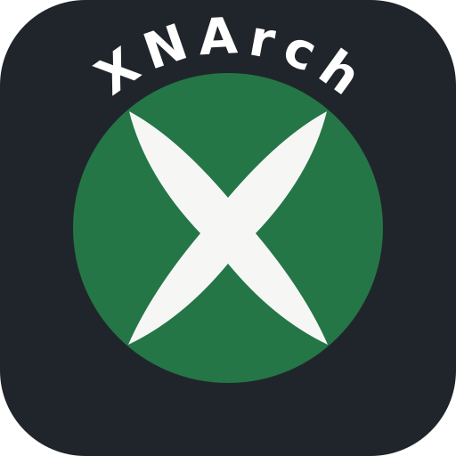

<div align="center">



# XNArch

Your Microsoft Store PC games, on Arch Linux.

[](LICENSE)

</div>

> [!CAUTION]
> **XNArch is just a slightly tweaked and cleaned up version of [Xodus Nexus](https://github.com/domsvoboda/xodus-nexus) v0.3.12, packaged as a Flatpak for Arch Linux.**
>
> It is an independent, unofficial project. It is not an official release from the Xodus Nexus or [Xodus](https://github.com/xodus-gaming/xodus) developers, and they do not support it. Please do not report XNArch problems to their issue trackers or support channels.
>
> All credit for the original work goes to the Xodus Nexus and Xodus developers.

An Xbox-inspired launcher for Microsoft Store PC games. Browse the Store, install
games you own or can access through a subscription, and play them with one shared
Wine / Proton runtime. Xbox sign-in and cloud saves work for supported games.

## What is different from Xodus Nexus

- Cleaner interface and a more useful Store: Apps next to Games, clear price labels (Free, Free-to-play, Included, paid), paging for featured lists and store recommendations.
- A Flatpak build target for Arch Linux (`npm run dist:flatpak`).
- The dev window runs on X11 with the GPU disabled for stability on Wayland desktops.
- Upstream bug-report, wiki and support links are removed from the project docs and the first-run notice.

## Download

Get the Flatpak from the [latest release](https://github.com/Thri11ride/XNArch/releases/latest)
([direct download](https://github.com/Thri11ride/XNArch/releases/download/v0.3.12-xnarch.1/XNArch-v0.3.12-xnarch.1.flatpak)), then install it:

```sh
flatpak install --user XNArch-v0.3.12-xnarch.1.flatpak
```

## Build

Requires Node.js, `flatpak` and `flatpak-builder`.

```sh
npm install
npm run dev            # run from source
npm run dist:flatpak   # build a local Flatpak bundle into release/
```

Flatpak support is experimental. Sandbox permissions can limit access to game
folders and desktop integrations, and Flatpak Steam is not supported.

## Set up

In **Settings**, install the **Nexus backend** and **Nexus runtime**, then sign in
with your Microsoft account. A valid game purchase or subscription is required.

If passkey sign-in gets stuck, choose **Continue in browser** in the sign-in
window. This requires Google Chrome, either native or the Flatpak version.
Other browsers are not supported.

## Use

- **My Library** combines owned, Game Pass and installed games, with Access, Play state and title filters.
- Open a game for its description, screenshots, Xbox achievements, time played and last activity. Xbox data depends on the account and game.
- **Store** lets you browse and install supported PC games and apps.
- **Manage content** installs licensed add-ons and campaign packages.
- **Install Queue** downloads one game at a time, supports pause and resume, and lets you queue more while another game plays.
- Right-click an installed game for settings, VC++ prerequisites, shortcuts or removal. Removing a game can keep its files or permanently delete its install folder; saves inside that folder are deleted too.
- Choose **Add to Steam** in the game menu to create a Non-Steam shortcut. Requires native Linux Steam.
- **Settings → Downloads** sets a combined download speed limit in MiB/s (0 means unlimited).
- For account, library or install errors, use **Settings → Xodus backend → Open backend diagnostic log**. The log contains safe error codes, not credentials. Review it before sharing.

## Wallet setup

- If the keyring service is stopped, use **Start service**.
- If your wallet has a password, enter your **wallet password**, which is not necessarily your Microsoft password. XNArch never receives it.
- If no wallet exists, use **Create wallet**. On KDE, choose **Classic, blowfish encrypted file** unless you have a GPG key. An empty password does not protect stored credentials.

## Microsoft Store device limit

Microsoft Store supports up to 10 linked devices. If a download or launch fails with
**Microsoft Store device limit reached** (licensing code 501), open
[Microsoft Store device management](https://account.microsoft.com/devices/content),
sign in with the same account and unlink an old device you no longer use.

## How it works

| Component | Role |
| --- | --- |
| XNArch | Store browsing, library, install queue and launch controls. |
| Nexus backend | Patched build of [Xodus](https://github.com/xodus-gaming/xodus) for sign-in, license checks, package downloads and launch preparation. |
| Nexus runtime | Shared [Wine](https://www.winehq.org/) / [Proton](https://github.com/ValveSoftware/Proton) runtime with [Xodus XGameRuntime](https://github.com/xodus-gaming/xgameruntime) and compatibility patches. |

## Credits and license

XNArch is based on [Xodus Nexus](https://github.com/domsvoboda/xodus-nexus), which is
built on [Xodus](https://github.com/xodus-gaming/xodus). Thank you to their developers.
Released under the MIT License; see [LICENSE](LICENSE).
